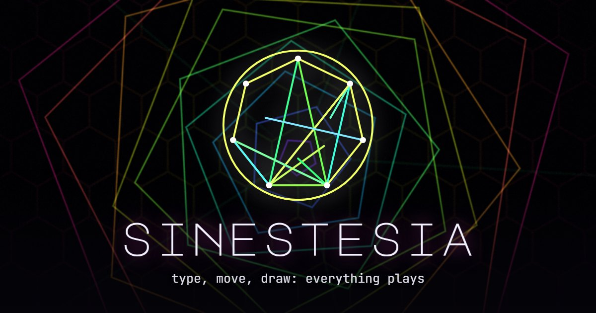

<p align="center">
  <a href="https://sinestesia.lol/"></a>
</p>

<h1 align="center">sinestesia</h1>

<p align="center">
  <b>A techno playground in your browser.</b><br>
  You type, it plays. You move the mouse, it bends. You draw a triangle, things catch fire.<br>
  <br>
  👉 <a href="https://sinestesia.lol/"><b>sinestesia.lol</b></a> 👈<br>
  <sub>(headphones on, volume down, then press Play)</sub>
</p>

---

## What is this?

Synesthesia is when your senses get their wires crossed and you start *hearing colours*. This is that, but on purpose, and with an acid bass line.

Everything is synthesized live in the browser: no samples, no plugins, no account, nothing to install. Just a page that turns whatever you do into techno and psychedelic visuals.

It was made for fun. It is still being made for fun. That is the whole business plan.

## Things to try

- ⌨️ **Type anything.** Every letter is a note. Press **Enter** and your phrase becomes a whole groove, picked from its SHA-256 hash. The same words always give the same music, so yes, your name has a song. Go find out what it sounds like.
- 🖱️ **Move the mouse.** It opens the filter and stretches the echo. Hold the button and you get a theremin.
- ✍️ **Draw shapes** on the screen: a circle, a triangle, a square, a spiral… Each one is a spell. We will not tell you what they do.
- 🎛️ **Open the Studio**, a little groovebox:
  - a six-track drum grid with accents and rolls;
  - an acid bass line you can edit note by note;
  - eight pattern slots you can chain into a song;
  - live FX pads: beat repeat, tape stop, freeze, bitcrush and friends;
  - a **Madness** knob, for when your pattern is too well-behaved.
- 🔗 **Share your track.** It fits entirely in a link. Send it to a friend; their link never overwrites your own track, so nobody gets hurt.
- 👥 **Duet.** Open the same link on two computers (or with up to eight people) and jam together, each on your own instrument.
- 📻 **Pirate radio.** Turn the dial. Some stations are not quite stations.
- ₿ **Bitcoin mode.** Live transactions and blocks from the real network become notes. Finally, a good use for the blockchain.

## 📡 The Signal

There is also a story. Thirteen chapters, about twenty minutes, three endings.

Something is hiding in the noise and it is trying to talk to you. Every chapter is a small musical puzzle, and together they quietly teach you everything the playground can do. No spoilers here; just press **✧ Story**.

Your progress is saved, so you can leave and come back. The full script, spoilers and all, is in [`docs/the-signal.md`](docs/the-signal.md).

## Run it yourself

You need Node 18 or newer.

```bash
npm install
npm start
```

Then open <http://localhost:3000>. The port comes from `PORT` if you set it.

No Node? Any static server pointed at `public/` runs everything except the duet:

```bash
python -m http.server -d public 8765
```

### Put it online

There is a `Dockerfile`, and that's all you need. With [Coolify](https://coolify.io/) (the way sinestesia.lol runs):

1. Create a resource from this repository and pick the **Dockerfile** build pack.
2. Set the port to `3000` and the health check path to `/healthz`.
3. Add your domain. HTTPS and WebSockets just work.

No database, no secrets, no volumes. One small container is plenty. If you ever run more than one, the players of a duet must land on the same one, because rooms live in memory.

## How it's built

Short version: plain HTML, CSS and JavaScript, with **no build step**. The Web Audio API makes the sound, WebGL makes the visuals, and one tiny Node process with exactly one dependency ([`ws`](https://github.com/websockets/ws)) serves the page and the duet rooms.

```
server/             one Node process, one dependency
  server.js         starts on $PORT, shuts down cleanly on SIGTERM
  app.js            the HTTP server and /healthz
  static.js         serves public/ with security headers, ETags and brotli/gzip,
                    and writes the preview image's full address into the page
  rooms.js          the duet's rooms, a WebSocket at /ws?room=<code>
public/
  index.html        the markup; a feature's elements carry data-needs="<feature>"
  css/style.css
  fonts/            JetBrains Mono and Major Mono Display (OFL), served from here
  img/              the icon (the sigil of the word "sinestesia") and the link preview
  js/main.js        starts the music and imports every feature
  js/core/          always loaded: state, event bus, audio graph, instruments,
                    voices, sequencer, visuals, shaders…
  js/features/      studio, story, journey, machine, mining, radio,
                    spells, duet, files, bitcoin, record, keys, tips
```

### Features are plug-ins (kind of)

The core never imports a feature, and features never import each other. Each feature registers itself when it loads: it listens to the core's events (every bar, every step, every frame, every note you play) and offers actions to the others. [`public/js/core/bus.js`](public/js/core/bus.js) lists every event.

So, to **remove a feature**, delete its line in [`public/js/main.js`](public/js/main.js). That's it. Its buttons hide themselves, because markup tagged `data-needs="<feature>"` only appears once that feature has loaded. The story notices too, and skips the chapters that needed it.

| Feature | Uses, if present | Without it |
|---|---|---|
| story | radio, studio, spells, mining | skips the chapter played with it (Shortwave, The Factory, The Storm, The Vault) |
| story | keys | the Archive chapter is played with the letter keys |
| story | machine | the "stay" ending does not switch the machine on |
| radio, studio | story | her station, her greeting and her rhythm in slot H never appear |

### The duet server

A room is just a code in the link. Each page publishes a small "presence" (cursor, instrument, name, the groove it is playing, its last few moves), and the server relays every change to the others. It never interprets the music: each page checks what it receives. The server also shares its clock, so everyone's bars line up.

Limits, in [`server/rooms.js`](server/rooms.js): 8 players a room, 1000 rooms, 16 KB a message, 60 messages a second per page.

## Tests

```bash
npm test
```

Server tests: static files, headers, compression, link previews, the health check and the duet rooms. They take a few seconds.

```bash
npx playwright install chromium
npm run test:e2e
```

Browser tests in a headless Chromium:
- **Story:** a robot plays every chapter of The Signal the way a person would. It taps the heartbeat, tunes the radio, draws the spells and releases the drop on the one. Then it checks all three endings.
- **Studio:** opens track links and codes and makes sure your own track is never lost.
- **Phone:** opens the page as a Pixel 7 with a touch screen.

They take a few minutes, mostly because the story politely waits for whole bars of music.

## Privacy

The page loads nothing from other hosts, fonts included. No analytics, no cookies, no tracking. What you make is kept only in your own browser. The only outside connections are the two public Bitcoin feeds ([blockchain.info](https://www.blockchain.info/) and [mempool.space](https://mempool.space/)), and only while Bitcoin mode is on.

## ⚠️ A friendly warning

Sinestesia has moving lights and intense colours. If you are sensitive to flashing light, turn **Visions** down in the controls; the page also respects your system's *reduce motion* setting. And please mind your ears: it starts quiet, but acid bass is acid bass.

---

<p align="center"><sub>Made for fun. Now go type your name and see what it sounds like.</sub></p>
